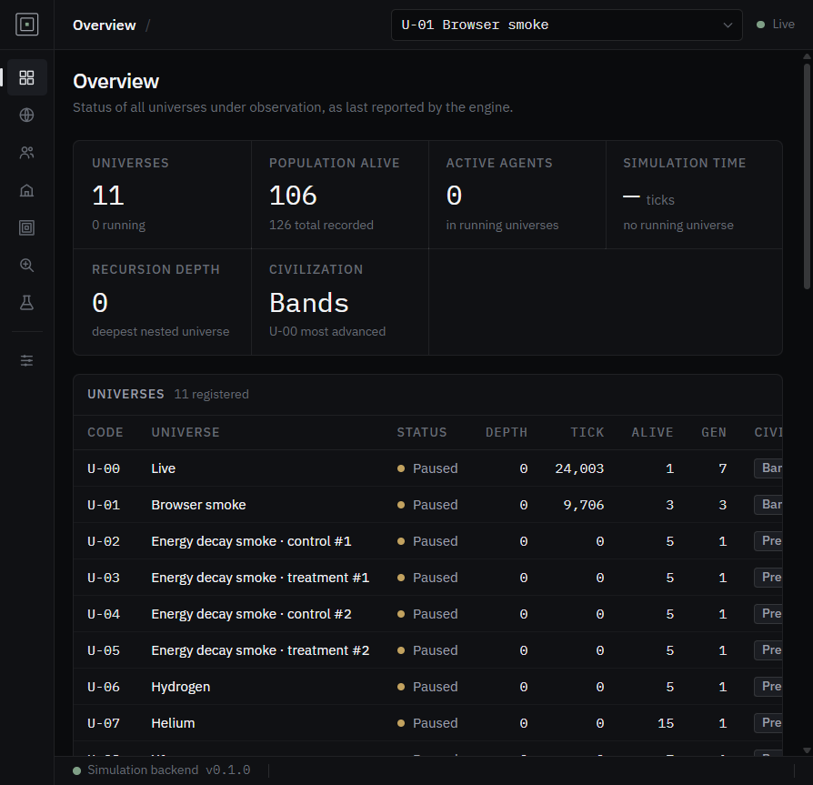
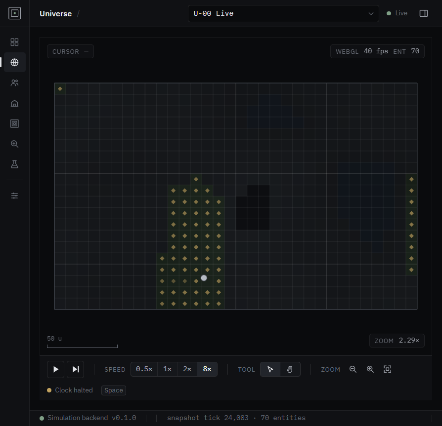
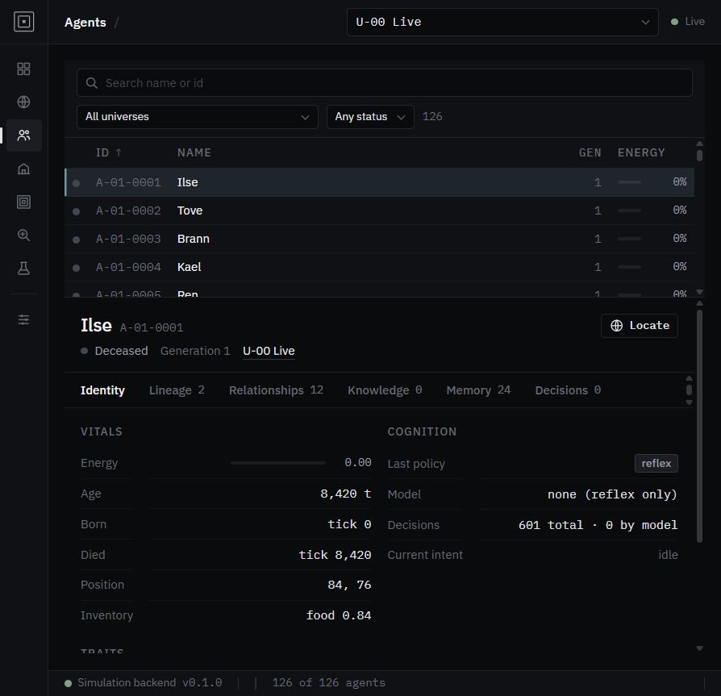
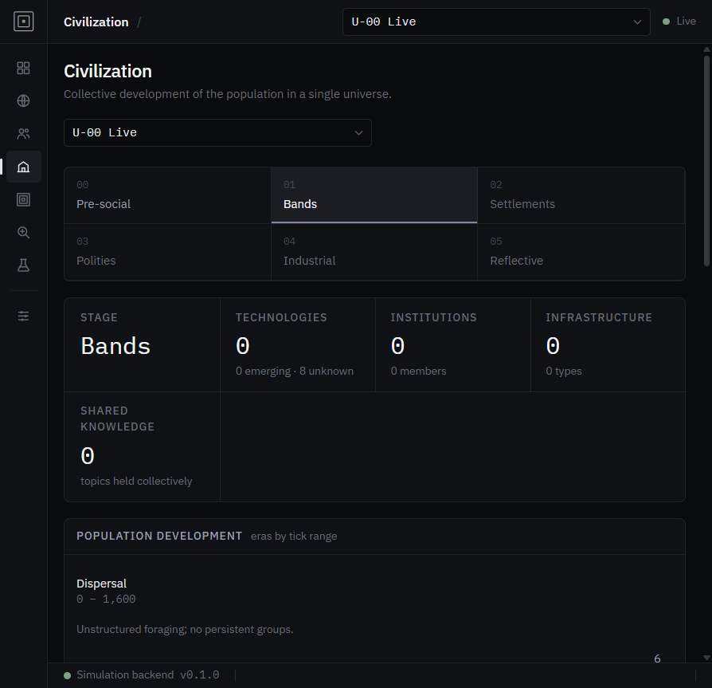
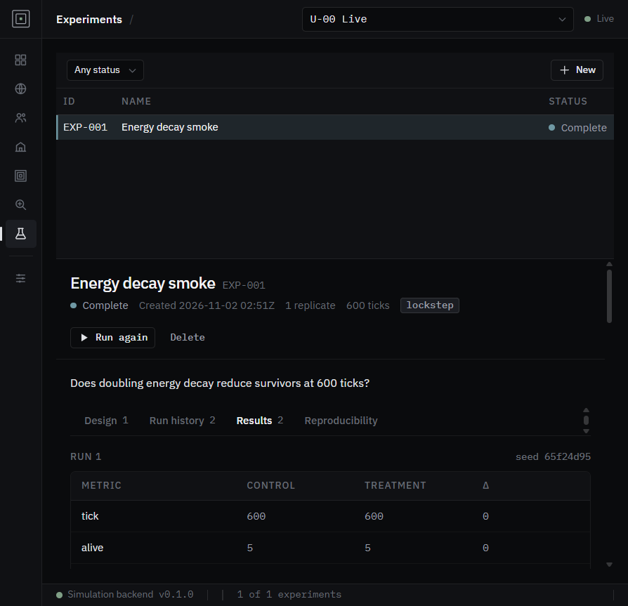
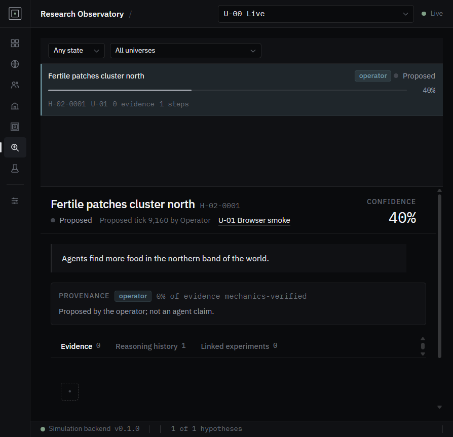
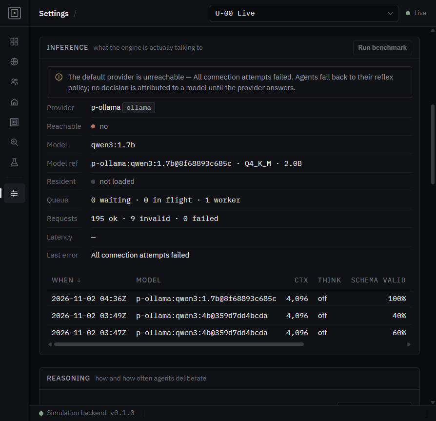

# RECURSION

A local artificial-life research platform. Populations live in seeded universes. A deterministic mechanics engine advances the world. Language models may propose what an agent does next, but they never write world state. Claims made by agents carry a provenance classification, and operator experiments run as paired control and treatment universes.

This repository is the engine, the observation interface, and the tests. It does not ship model weights, a database, or API credentials.

## Interface

These are the live observatory, captured against a local backend. The universe view is the world the mechanics are actually simulating. Experiments compare a control arm with a treatment arm. The observatory tags every claim with its provenance. Settings reports whether a model is reachable, and it keeps the benchmark measurements.

<p>
  
</p>

<p>
  
</p>

<p>
  
</p>

<p>
  
</p>

<p>
  
</p>

<p>
  
</p>

<p>
  
</p>

## What is recorded

Every universe stores its seed, engine version, mechanics version, and configuration. Every model call stores the model reference, prompt version, prompt hash, seed, context size, thinking flag, raw response, and whether the mechanics accepted the action. A hypothesis is classified as one of:

- `prompt-exposed` — the claim reuses vocabulary the agent already saw in prompts or messages
- `evidence-linked` — the claim is tied to measurements produced by the mechanics
- `model-originated` — the model asserted it without verified evidence
- `operator` — entered by the person running the experiment

An experiment is marked deterministic only when it runs in lockstep and no live model can vary the outcome (reasoning off, or the `scripted` / `replay` adapter). Same seed and same engine version reproduce the same state hash.

## Layout

| Path | Role |
| --- | --- |
| `backend/` | FastAPI process: simulation, cognition, civilization, research, experiments, SQLite |
| `frontend/` | React observatory. Reads state and sends operator commands. No simulation of its own |
| `start.bat` | Windows launcher for both processes |
| `backend/README.md` | Setup, API and WebSocket contract, scientific-integrity notes |
| `frontend/README.md` | UI scripts and the data-source boundary |

## Run

Requirements: Python 3.12, Node.js, and optionally [Ollama](https://ollama.com) for model-driven agents. Without a model, agents act on the reflex policy and the interface still works.

```powershell
cd backend
py -3.12 -m venv .venv
.\.venv\Scripts\Activate.ps1
pip install -r requirements.txt -r requirements-dev.txt
python -m uvicorn app.main:app --host 127.0.0.1 --port 8000
```

```powershell
cd frontend
npm install
npm run dev
```

Or, on Windows, double-click `start.bat` after the virtualenv and `npm install` exist. The interface is at <http://localhost:5173>. The API is at <http://127.0.0.1:8000/api/docs>.

`frontend/.env.development` points the dev server at the local backend through the Vite proxy. Copy `frontend/.env.example` to `frontend/.env.local` and set `VITE_DATA_SOURCE=static` to browse the bundled sample fixtures with no backend.

For model decisions, install Ollama 0.9 or newer (Qwen3 needs at least 0.6.6), then `ollama pull qwen3:1.7b` or `qwen3:4b`. Set the model in Settings and click Apply. Provider credentials for OpenAI-compatible endpoints are stored only in the local database and are never returned to the browser.

```powershell
cd backend
python -m pytest -q
ruff check app tests scripts
cd ../frontend
npm run typecheck
npm run lint
```

## What stays off GitHub

The root `.gitignore` excludes:

- `backend/.venv/` and `frontend/node_modules/`
- `backend/data/`, including `recursion.sqlite3` and its journal files. That database holds universes, inference logs, and any provider credential you set
- `.env` files other than the committed examples

Do not force-add those paths. `.env.example` and `.env.development` contain no secrets.

## Citation

See `CITATION.cff`.

## License

[MIT](LICENSE). Copyright 2026 Rajab Ali Abbas.
